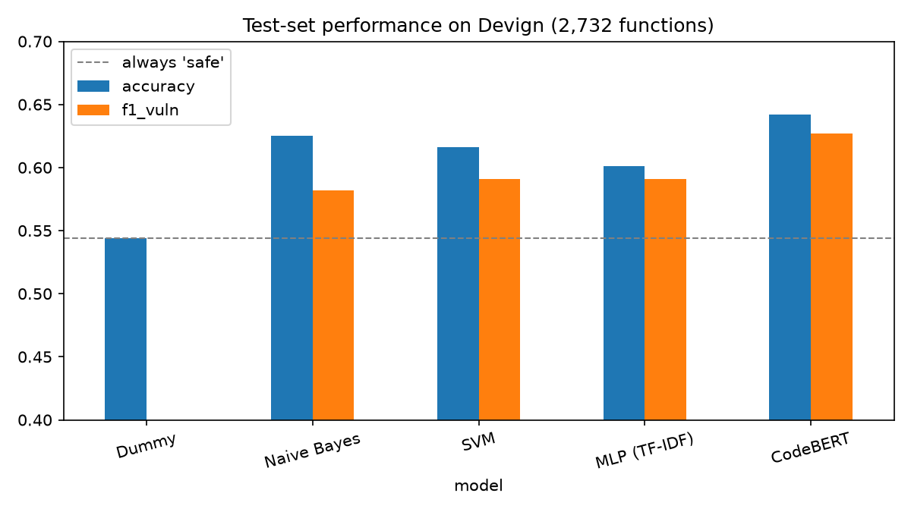
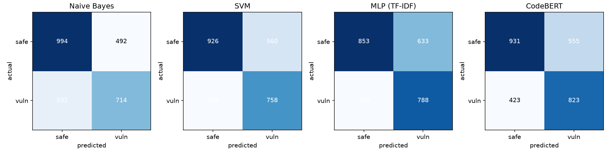
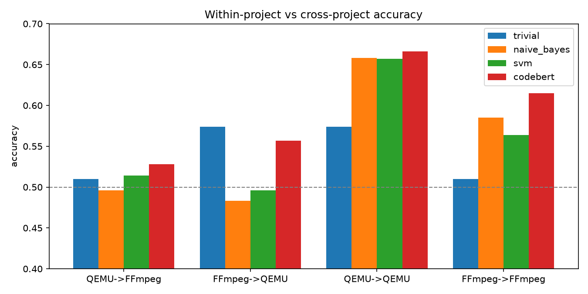

# Code Vulnerability Detection: Classical ML vs Neural Networks

Can machine learning tell vulnerable C functions from safe ones? This project compares **classical ML** (Naive Bayes, linear SVM) with **neural networks** (an MLP on TF-IDF features and a fine-tuned **CodeBERT**) on the Devign dataset, and then stress-tests the results with two harder evaluations: a **commit-grouped split** and a **cross-project split**.

The headline finding is about evaluation, not about a model: **the scores on a standard random split look reasonable (about 60 to 64% accuracy), but they collapse to the level of a trivial baseline once functions from the same commit are kept apart.**

## TL;DR

- Task: binary classification of C functions (vulnerable vs. safe) on Devign (27,318 functions from QEMU and FFmpeg).
- **Random split:** all models score about 60 to 64% accuracy (always guessing "safe" gives 54.4%). The fine-tuned CodeBERT is best at 64.2%, but only by about 2 to 4 points.
- **Leakage check:** 64.7% of the random test set's functions come from a commit that also appears in the training set. When the split is grouped by commit, **Naive Bayes, SVM and CodeBERT all drop to the always-"safe" baseline** (about 53 to 54% accuracy).
- **Cross-project split** (train on QEMU, test on FFmpeg and vice versa): every model falls to about chance level.
- Conclusion: in this setup, neither classical ML on bag-of-words features nor a fine-tuned CodeBERT detects vulnerabilities in a way that generalizes. The apparent performance on the random split is consistent with models recognizing the surrounding code (the commit and the project) rather than the vulnerability.

## Dataset

[Devign](https://sites.google.com/view/devign) (Zhou et al., 2019): 27,318 manually labeled C functions from two open-source projects, QEMU (17,549) and FFmpeg (9,769). Each function is labeled vulnerable (1) or non-vulnerable (0). Class balance: 54.4% safe, 45.6% vulnerable. The functions come from 12,316 distinct commits (median 1 function per commit, largest commit 588 functions).

The dataset is not included in this repository. Download `function.json` from the Devign website and place it in `data/`.

**Random split:** 80/10/10 train/validation/test, stratified on the label, `random_state=42` (21,854 / 2,732 / 2,732 functions). All models in the main results table use this split.

**Grouped split:** the same data split with `GroupShuffleSplit` on `commit_id`, so no commit appears in more than one set (21,895 / 2,972 / 2,451 functions; the test set is 46.8% vulnerable, so always guessing "safe" scores about 0.532).

## Methods

**Preprocessing (all models):** remove block and line comments, collapse whitespace.

**Classical ML**
- Features: TF-IDF over code-aware tokens (identifiers, numbers and operators such as `->`, `&&`, `==` kept as separate tokens), unigrams and bigrams, `min_df=2`, top 50,000 features, fit on the training set only.
- Multinomial Naive Bayes, `alpha=0.01`.
- Linear SVM (`LinearSVC`), `C=0.5`, `class_weight="balanced"`.

**Neural networks**
- **MLP on TF-IDF:** the same 50,000 features feed a 256-unit hidden layer (ReLU, dropout 0.5) and a 2-class output. Adam (lr 1e-3), class-weighted loss, 10 epochs, best epoch chosen on validation F1.
- **CodeBERT:** `microsoft/codebert-base` fine-tuned end to end with a classification head. AdamW (lr 2e-5), linear warmup and decay, class-weighted loss, 3 epochs, mixed precision (fp16), batch size 8 with 2 accumulation steps, inputs truncated to 512 tokens. Training on the Devign training set took about 20 minutes on an RTX 2070 Super (8 GB).

**Baseline:** a dummy classifier that always predicts the majority class.

**Evaluation protocol:** hyperparameters were tuned on the random-split validation set only, then frozen. Each model was evaluated on the test set once. The same frozen settings were reused, without re-tuning, for the grouped and cross-project experiments. CodeBERT was trained twice on the random split (the first run's weights were lost in a notebook restart before testing), and only the second run was evaluated on the test set.

## Results on the random split

Test set (2,732 functions):

| Model | Accuracy | Precision (vuln) | Recall (vuln) | F1 (vuln) |
|---|---|---|---|---|
| Dummy (always "safe") | 0.544 | n/a | 0.000 | n/a |
| Naive Bayes | 0.625 | 0.592 | 0.573 | 0.582 |
| Linear SVM (balanced) | 0.616 | 0.575 | 0.608 | 0.591 |
| MLP on TF-IDF | 0.601 | 0.555 | 0.632 | 0.591 |
| **CodeBERT (fine-tuned)** | **0.642** | 0.597 | **0.661** | **0.627** |





With 2,732 test samples, the margin of error on accuracy is roughly +/-1.8 points, so CodeBERT's lead is suggestive at best. The MLP is no better than the simpler models, which points to the bag-of-words features as the bottleneck. **These numbers turned out to be optimistic; see the next section.**

## Leakage check: commit-grouped split

In Devign, one commit often contributes several functions, usually from the same files and with the same label. With a random split, 64.7% of the test functions have a "sibling" from the same commit in the training set, so a model can score well by recognizing the commit's code, not the vulnerability.

To test this, the data was re-split so that every commit lives in exactly one set, and the models were retrained with the same frozen settings (grouped test set: 2,451 functions, margin of error about +/-2 points):

| Model | Accuracy | Precision (vuln) | Recall (vuln) | F1 (vuln) |
|---|---|---|---|---|
| Always "safe" | 0.532 | n/a | 0.000 | n/a |
| Naive Bayes | 0.537 | 0.504 | 0.533 | 0.518 |
| Linear SVM (balanced) | 0.527 | 0.494 | 0.542 | 0.517 |
| CodeBERT | 0.537 | 0.505 | 0.453 | 0.478 |

All three models land at the trivial baseline, about 9 to 11 points below their random-split accuracy. The MLP was not re-evaluated on the grouped split. The drop is consistent with the random-split scores being driven largely by commit-level leakage.

## Does it generalize to a new codebase?

Each model was trained on one project and tested on the other, and compared with training and testing within the same project (80/20 random split per project, so the within-project numbers are subject to the same leakage). The "trivial" column is the better of always-safe and always-vulnerable on that test set.

Accuracy:

| Trained on -> tested on | Trivial | Naive Bayes | SVM | CodeBERT |
|---|---|---|---|---|
| QEMU -> FFmpeg | 0.510 | 0.496 | 0.514 | 0.528 |
| FFmpeg -> QEMU | 0.574 | 0.483 | 0.496 | 0.557 |
| QEMU -> QEMU | 0.574 | 0.658 | 0.657 | 0.666 |
| FFmpeg -> FFmpeg | 0.510 | 0.585 | 0.564 | 0.615 |



Across projects, every model falls to about chance level. CodeBERT is slightly less bad than the TF-IDF models, but its FFmpeg -> QEMU accuracy (0.557) is still below the 0.574 of always guessing "safe", and its recall on the vulnerable class is only about 0.33 to 0.36 in both directions.

## What are the classical models learning?

The highest-weighted SVM features (random-split model) show that much of the signal is not about vulnerabilities:

- `target_phys_addr_t` (pushes toward safe) and `hwaddr` (pushes toward vulnerable) look like two eras of the same QEMU codebase, so the model partly encodes *when* a function was written.
- Subsystem-specific names such as `qdev_init`, `ahci`, `config_reg` and `gen_inval_exception` push toward vulnerable, which reflects how the dataset is labeled in those parts of the code, not a general vulnerability pattern.
- Structural tokens (`}`, `{`, `; }`) appear near the top, probably acting as proxies for function length and shape.
- Classic danger signs such as `memcpy` or `strcpy` do not appear among the top 20 features in either direction.

This is consistent with the grouped and cross-project results above.

## Limitations

- **Bag-of-words cannot read code logic.** Vulnerabilities such as missing bounds checks depend on how statements relate, which TF-IDF features cannot express.
- **CodeBERT constraints.** Inputs are truncated at 512 tokens, so long functions lose their tails. CodeBERT's pretraining covered Python, Java, JavaScript, PHP, Ruby and Go, not C.
- **Label noise.** Devign's labels come from security-related commits, and prior work has reported a notable fraction of mislabeled samples, which limits any model's ceiling.
- **One grouped split, single runs.** The grouped experiment uses one random grouped split and one training run per model. A few very large commits make the split sizes uneven. Differences of a point or two should not be over-interpreted.
- **Tuning happened on the random split.** The hyperparameters were chosen on a validation set that shares commits with the training data. With only a handful of settings tried, the effect is probably small, but the settings were not re-tuned for the grouped split.
- **Not every experiment was repeated everywhere.** The MLP was not run on the grouped split, and the within-project numbers in the cross-project table use random splits, so they carry the same leakage.
- **Two projects, one language.** Results may not hold for other codebases or languages.

## Future work

- Re-tune all models (including the MLP) on the grouped split, and repeat with several random seeds and grouped splits.
- Group-aware cross-validation for tighter confidence intervals, and a significance test between models on the same samples (for example McNemar's test).
- Handle long functions (sliding windows or chunking) and try code models pretrained on C/C++.
- Extend to C++ (for example DiverseVul) and PHP (for example CVEfixes), always with commit- or project-aware splits.

## Reproducing the results

```bash
git clone https://github.com/sushant921/vuln-detection-ml.git
cd vuln-detection-ml
python -m venv venv
venv\Scripts\activate        # Windows (Mac/Linux: source venv/bin/activate)
pip install -r requirements.txt
```

Install PyTorch first using the command from [pytorch.org](https://pytorch.org) that matches your hardware (the pinned CUDA build in `requirements.txt` will not install from the default package index). A CUDA GPU is needed for the CodeBERT notebooks; the rest runs on CPU.

1. Download `function.json` from the Devign website into `data/`.
2. Run the notebooks in order:
   - `notebooks/01_explore.ipynb`: data exploration and the random train/validation/test split.
   - `notebooks/02_baseline.ipynb`: TF-IDF features, Naive Bayes and SVM, tuning, token analysis, test evaluation.
   - `notebooks/03_cross_project.ipynb`: cross-project experiment for Naive Bayes and SVM.
   - `notebooks/04_neural_net.ipynb`: MLP on TF-IDF features.
   - `notebooks/05_codebert.ipynb`: CodeBERT fine-tuning and test evaluation (random split).
   - `notebooks/06_codebert_cross_project.ipynb`: CodeBERT cross-project experiment and the grouped-split run (results saved to `results/codebert_cross_project.csv`).
   - `notebooks/07_results_plots.ipynb`: summary tables and charts (values transcribed from the notebook outputs).
   - `notebooks/08_grouped_split.ipynb`: leakage check, grouped split, and Naive Bayes / SVM on it.

## Project structure

```
vuln-detection-ml/
├── data/            # datasets (not committed)
├── models/          # saved model weights (not committed)
├── notebooks/       # 01_explore ... 08_grouped_split
├── results/         # saved experiment results and charts
├── src/             # reusable code
├── requirements.txt
└── README.md
```

## Tech stack

Python, scikit-learn, pandas, NumPy, PyTorch, Hugging Face Transformers, Jupyter.

## References

Zhou, Y., Liu, S., Siow, J., Du, X., Liu, Y. *Devign: Effective Vulnerability Identification by Learning Comprehensive Program Semantics via Graph Neural Networks.* NeurIPS 2019.

Feng, Z. et al. *CodeBERT: A Pre-Trained Model for Programming and Natural Languages.* Findings of EMNLP 2020.
